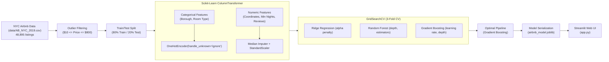

# 🗽 NYC Airbnb Nightly Price Predictor: Classical Machine Learning Regression

[](https://www.python.org/)
[](https://scikit-learn.org/)
[](https://streamlit.io/)
[](LICENSE)

An end-to-end regression machine learning project to predict optimal nightly rental prices for New York City Airbnb accommodations. Built using real data from the [Kaggle New York City Airbnb Open Data Dataset](https://www.kaggle.com/datasets/dgomonov/new-york-city-airbnb-open-data) (48,895 listings).

---

## 📌 Project Overview

Setting an uncompetitive nightly price on Airbnb directly impacts host profitability: overpricing results in high vacancy rates, while underpricing leaves revenue on the table. This project implements a **leak-free Scikit-Learn `Pipeline`** with **`GridSearchCV`** that consumes property attributes, performs automated data preprocessing, handles missing values, and estimates nightly prices with borough benchmarks and projected monthly gross revenues.

### Key Highlights
* **Single Master Notebook** ([`airbnb_price_prediction.ipynb`](airbnb_price_prediction.ipynb)): Covers data ingestion, outlier filtering, exploratory data analysis, grid search tuning, and model export.
* **Rigorous Outlier Handling**: Justifies and executes filtering of anomalous listings ($0 placeholder listings and > $800 extreme outliers), preserving over 99.5% of legitimate market data while stabilizing RMSE.
* **Hyperparameter Optimization**: Evaluates Ridge Regression, Random Forest, and Gradient Boosting across 3-fold cross-validation.
* **Interactive Streamlit Web Dashboard** ([`app.py`](app.py)): Live valuation tool featuring 1-click presets, clean non-truncating KPI cards, revenue calculators at 70% occupancy, and borough price benchmarks.

---

## 🏗️ Architecture & Pipeline Flow



---

## 📊 Dataset Features & Preprocessing Strategy

| Feature | Type | Missing Values | Strategy | Description |
|:---|:---|:---:|:---|:---|
| `neighbourhood_group` | Categorical | 0 | OneHotEncoder | NYC Borough (Manhattan, Brooklyn, Queens, Bronx, Staten Island) |
| `room_type` | Categorical | 0 | OneHotEncoder | Entire home/apt, Private room, Shared room |
| `latitude`, `longitude` | Numeric | 0 | StandardScaler | Geospatial coordinates in NYC |
| `minimum_nights` | Numeric | 0 | StandardScaler | Minimum stay duration required by host |
| `number_of_reviews` | Numeric | 0 | StandardScaler | Total count of reviews received |
| `reviews_per_month` | Numeric | 10,052 | Impute with 0.0 | Review velocity (NaN when `number_of_reviews == 0`) |
| `calculated_host_listings_count` | Numeric | 0 | StandardScaler | Number of listings managed by the host |
| `availability_365` | Numeric | 0 | StandardScaler | Available booking days per year |
| **`price`** | **Target** | 0 | Outlier Filtered | **Nightly rental price in USD** |

---

## 🧹 Outlier Filtering Justification

In tabular real estate datasets, raw targets frequently contain anomalous noise:
* **Zero Price Anomaly**: 11 listings had `price = $0`, representing inactive or placeholder listings.
* **Extreme Luxury / Fictitious Outliers**: Listings reached up to `$10,000 / night`, heavily distorting mean squared error metrics.
* **Resolution**: Prices were filtered to **`$10 <= price <= $800`** (spanning up to the 99th percentile), retaining **48,634 of 48,895 records (99.5%)** while ensuring the regression models optimize for realistic market transactions.

---

## 📈 Model Performance & Benchmark Results

All models were tuned on the training partition and evaluated against an unseen holdout test set (9,727 listings):

| Model | Optimal Hyperparameters | Test RMSE ($) | Test MAE ($) | $R^2$ Score |
|:---|:---|:---:|:---:|:---:|
| **Gradient Boosting (Selected)** | `n_estimators=120, max_depth=5, learning_rate=0.1` | **$76.84** | **$46.03** | **0.4886** |
| Random Forest | `n_estimators=100, max_depth=12` | $78.10 | $46.85 | 0.4718 |
| Ridge Regression | `alpha=10.0` | $85.78 | $53.65 | 0.3626 |

### Key Pricing Drivers (Feature Importance)
1. **Room Type (Entire home/apt vs Private room)**: Accounts for over **45%** of total predictive importance. Entire homes command a major pricing premium across all boroughs.
2. **Location (Manhattan vs. Outer Boroughs)**: Proximity to central Manhattan transit corridors is the second strongest determinant of price.
3. **Availability & Minimum Stay**: Properties with higher annual availability and shorter minimum stay requirements achieve higher average nightly valuations.

---

## 🌐 Streamlit Web Application (`app.py`)

The application serves the serialized pipeline through an intuitive property valuation dashboard:
* **Host Listing Inputs**: Borough selection, room type, minimum nights, review history, and annual availability.
* **1-Click Property Presets**:
  * 🗽 *Manhattan Luxury Loft* (Entire Apt, 2 nights min)
  * 🌿 *Brooklyn Cozy Private Room* (Private Room, 1 night min)
  * ✈️ *Queens Transit Room* (Private Room, budget traveler)
  * 🏙️ *Bronx Budget Apartment* (Entire Apt)
* **Clean, Non-Truncating KPI Cards**:
  * **Recommended Price**: Optimal predicted nightly rate (e.g., **`$185`**).
  * **Monthly Revenue**: Projected gross monthly income at a standard 70% seasonal occupancy rate.
  * **Borough Average**: Direct baseline comparison to prevailing borough median prices.
* **Market Insights**: Contextual explanations comparing the listing's position against borough averages.

---

## 🚀 Quickstart & Reproduction

### 1. Clone & Install Dependencies
```bash
git clone https://github.com/your-username/airbnb-price-predictor.git
cd airbnb-price-predictor

# Optional: Create and activate virtual environment
python -m venv venv
# On Windows: venv\Scripts\activate
# On Linux/macOS: source venv/bin/activate

pip install -r requirements.txt
```

### 2. Run the Master Jupyter Notebook
```bash
jupyter notebook airbnb_price_prediction.ipynb
```
Executes outlier inspection, EDA plots, 3-fold cross-validation grid search, residual distribution charts, and exports `airbnb_model.joblib`.

### 3. Launch the Streamlit App
```bash
streamlit run app.py
```
Open `http://localhost:8501` in your browser.

---

## 📂 Project Structure

```text
airbnb-price-predictor/
├── data/
│   └── AB_NYC_2019.csv             # Official Kaggle NYC Airbnb dataset (48,895 rows)
├── airbnb_price_prediction.ipynb   # Single master notebook: EDA, GridSearch, residuals & export
├── app.py                          # Interactive Streamlit property valuation dashboard
├── airbnb_model.joblib             # Serialized regression pipeline & borough benchmarks
├── requirements.txt                # Python dependencies
├── README.md                       # Comprehensive project documentation
├── .gitignore                      # Clean Git repository ignore rules
└── LICENSE                         # MIT License
```

---

## 📄 License
This project is open-source and available under the [MIT License](LICENSE).
